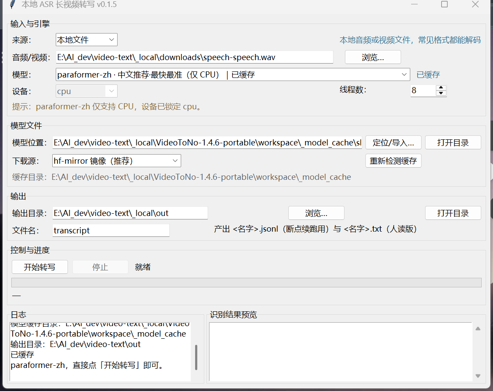
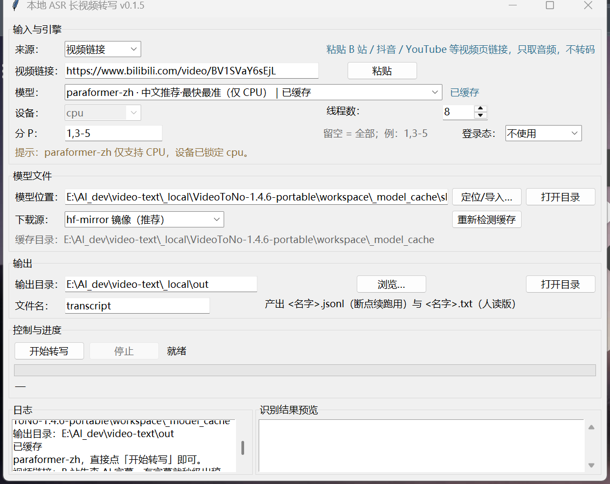
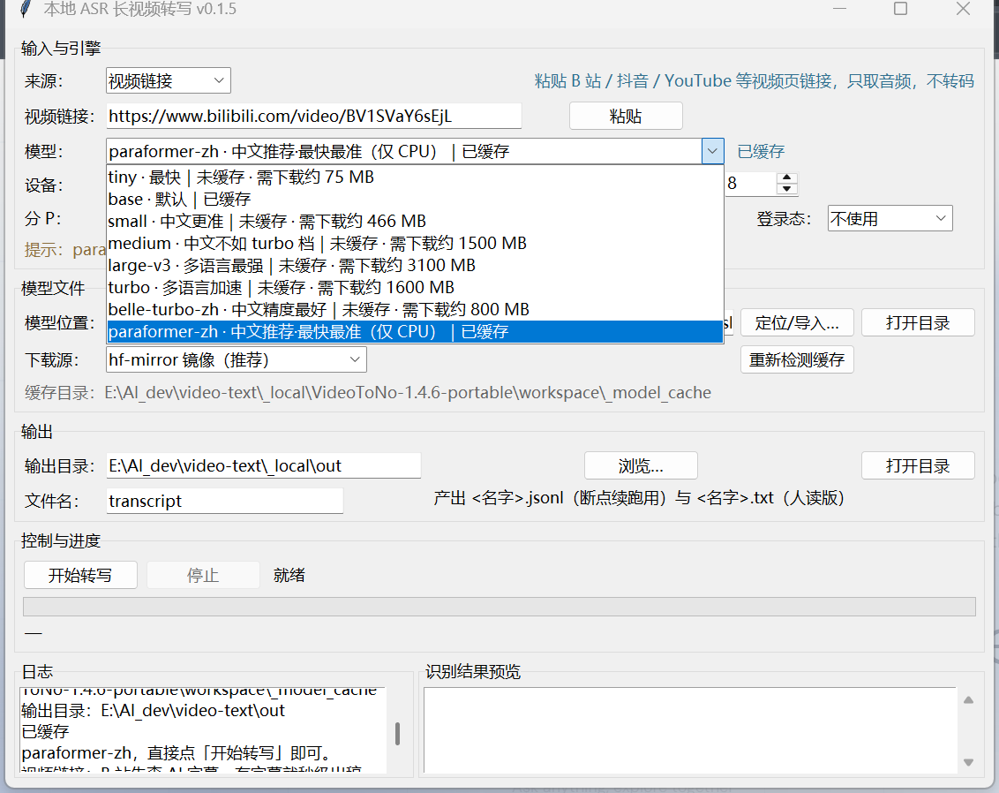

# asr-gui

[简体中文](README.md) · **English**

Turn hours-long videos into timestamped transcripts, entirely offline — no cloud APIs, no uploads,
no Qt/Electron. The GUI is plain tkinter; the engines are
[sherpa-onnx](https://github.com/k2-fsa/sherpa-onnx) (Paraformer for Chinese) and
[faster-whisper](https://github.com/SYSTRAN/faster-whisper).

Why it exists: existing tools are fine for short clips but stall on 9-hour videos — the packaged
builds stream decoded audio to a child process through a 64 KiB pipe, and once the buffer fills the
task hangs forever. This project rewrites the pipeline: single process, fixed-length chunk decoding,
per-chunk checkpoints on disk, cancellable and resumable.

[](https://github.com/acemilee/asr-gui/actions/workflows/ci.yml)
[](https://github.com/acemilee/asr-gui/releases/latest)
[](LICENSE)
[](pyproject.toml)



## Features

- **Three input sources**: video URL (downloads the audio track only), local audio/video, or a
  `.srt` / `.vtt` subtitle file (no model needed).
- **Very long videos**: a 10-hour file transcribes in one run; cancel any time and resume later.
- **Eight model tiers in one dropdown**, from `tiny` to `large-v3` plus Chinese-tuned
  `paraformer-zh`; each row shows `cached` or `not cached · ~XXX MB to download`.
- **Bilibili-aware**: prefers platform AI subtitles (instant when available), honours page
  selection (`1,3-5`), and can read browser login cookies.
- **Mirror-first downloads**: defaults to `hf-mirror.com`, switchable to the official endpoint;
  `.part` resume plus size validation.
- **Two outputs**: human-readable `[HH:MM:SS] text` and machine-readable JSONL, both written
  incrementally.
- **No extra GUI runtime**: tkinter + standard library; config and logs live outside the repo and no
  machine-specific paths are hard-coded.

## Quick start

### Windows (no Python required)

Download `ASR-GUI.exe` (~115 MB) from [Releases](https://github.com/acemilee/asr-gui/releases/latest)
and double-click it. Models are not bundled: pick a tier and press **Download model**, or point
**Locate / import…** at an existing cache.

```bat
certutil -hashfile ASR-GUI.exe SHA256
:: 500442FA191FD68DFFC34EB45B26E916E1724E4633917AC1735D41AFA5F81350
```

The exe is unsigned; if SmartScreen complains, choose "More info → Run anyway".

### Windows (from source)

```bat
setup.bat
asr_gui\run.bat
```

`run.bat` probes, in order: the `ASR_PYTHON` environment variable → `asr_gui\config.local.bat` →
`.venv` in the repo root → `PATH`. It then verifies imports and prefers `pythonw.exe` (no console
window).

### Linux / macOS

```bash
./setup.sh
.venv/bin/python asr_gui/app.py
```

tkinter is a separate package on some distros: Debian/Ubuntu `sudo apt install python3-tk`, Fedora
`sudo dnf install python3-tkinter`, macOS `brew install python-tk`. PyAV ships its own FFmpeg.

Requires **Python 3.9+**; CPU inference is enough. For GPU with faster-whisper you need an NVIDIA GPU
with CUDA 12: `python -m pip install nvidia-cublas-cu12 nvidia-cudnn-cu12`. `paraformer-zh` is
CPU-only.

## Input sources

| Source | You give it | What it does | Model needed |
| --- | --- | --- | --- |
| Video URL | Page URL, a whole share snippet, a link without `https://`, even a bare `BV1M6pc65Eox` | Bilibili subtitles first; otherwise yt-dlp downloads the audio track only, then transcription | Depends on subtitles |
| Local file | Path to an audio or video file | Decode and transcribe | Yes |
| Subtitle file | `.srt` / `.vtt` | Parse timings, write txt + jsonl immediately | No |



All three sources work from the command line too:

```bat
ASR-GUI.exe --transcribe sample.m4a --out out.txt --model paraformer-zh
ASR-GUI.exe --transcribe "https://www.bilibili.com/video/BV..." --pages 1,3-5 --cookies-from-browser chrome
ASR-GUI.exe --transcribe sample.srt --out out.txt
ASR-GUI.exe --selftest "%TEMP%\asr-gui-selftest.txt"
```

Flags: `--out` `--model` `--device` `--threads` `--pages` `--cookies-from-browser` `--cookies`
`--no-subtitle-first`.

## Models

Downloaded on demand and cached locally; repository names are the actual CTranslate2 / sherpa-onnx
conversion repos in use.

| Tier | Backend | Size | Device |
| --- | --- | --- | --- |
| `paraformer-zh` | sherpa-onnx (ASR + punctuation + VAD) | ~520 MB | CPU only |
| `tiny` / `base` / `small` | faster-whisper | 75 / 142 / 466 MB | CPU / CUDA |
| `medium` / `large-v3` | faster-whisper | 1.5 GB / 3.1 GB | CPU / CUDA |
| `turbo` / `belle-turbo-zh` | faster-whisper | 1.6 GB / 0.8 GB | CPU / CUDA |

`paraformer-zh` is the recommended default for long Chinese video: non-autoregressive, fast and
accurate on CPU. Whisper CT2 repos do not share a single file set, so the downloader requests the
right files per tier and validates a minimum size. Model weights carry their own licences — see
[THIRD_PARTY_NOTICES.md](THIRD_PARTY_NOTICES.md).



## Output

```text
[00:00:03] 大家好，欢迎来到本期节目。
[00:00:09] 今天我们聊一聊长视频转写。
```

```json
{"start": 3.52, "end": 8.97, "text": "大家好，欢迎来到本期节目。"}
```

`<name>.txt` is for reading, `<name>.jsonl` for resuming and post-processing; both are appended as
transcription progresses. Multi-page videos are written as `<name>.p1.jsonl`,
`<name>.p2.jsonl`, then merged into a single txt by timeline order.

## Performance

Test machine: i9-13980HX / 63.6 GB / RTX 4060 Laptop; material is a real 10-hour Chinese video
(35990 s).

| Tier | Hardware | Time |
| --- | --- | --- |
| `paraformer-zh`, 16 threads, full 10 hours | CPU | **19 min 51 s** (measured with the v0.1.5 exe, 3181 segments) |
| Same, on a run with heavier CPU load | CPU | 64.8 min |
| `faster-whisper base`, fp16 | GPU | RTF 0.031 (short-clip baseline) |

Rule of thumb: desktop CPU with `paraformer-zh`, expect 20–70 minutes per 10 hours of audio depending
on load and thermal throttling. Decoding itself is cheap: PyAV → 16 kHz mono, RTF ≈ 0.0014.

## Development

```bash
python -m pip install -r requirements-dev.txt
python -m pytest tests -q      # 239 tests, ~4 s, no network, no model downloads
python -m ruff check asr_gui tests
```

Tests do not import the inference stack (deferred imports inside the engine), so CI needs no
multi-GB runtime. CI runs three groups: `ruff` + `compileall`; tests on Windows/Ubuntu × Python
3.11/3.13; and a check that `.bat` files stay ASCII + CRLF.

Packaging notes live in [packaging/README.md](packaging/README.md); changes in
[CHANGELOG.md](CHANGELOG.md).

## Known limitations

1. Progress is reported per 300 s chunk; cancellation for the whisper path takes effect at chunk
   boundaries only.
2. The resume point is the largest `end` in the JSONL, so a VAD segment spanning a chunk boundary
   may repeat once or lose a short piece.
3. The GUI is Chinese-only; CLI and docs are bilingual.
4. One file at a time — no batch queue, no subtitle-format export.
5. The exe is unsigned; existing browser login state is read, scanning a QR code is not supported.

## Credits

Inspired by [like-attract/video-to-note](https://github.com/like-attract/video-to-note) (MIT) — the
root cause of the long-video hang was diagnosed on its packaged build, and this engine is an
independent rewrite. The heavy lifting is done by
[sherpa-onnx](https://github.com/k2-fsa/sherpa-onnx),
[faster-whisper](https://github.com/SYSTRAN/faster-whisper),
[CTranslate2](https://github.com/OpenNMT/CTranslate2), [PyAV](https://github.com/PyAV-Org/PyAV) and
[yt-dlp](https://github.com/yt-dlp/yt-dlp).

## License

[MIT](LICENSE) © 2026 asr-gui contributors. Third-party components and model weights are covered by
their own licences — see [THIRD_PARTY_NOTICES.md](THIRD_PARTY_NOTICES.md).
