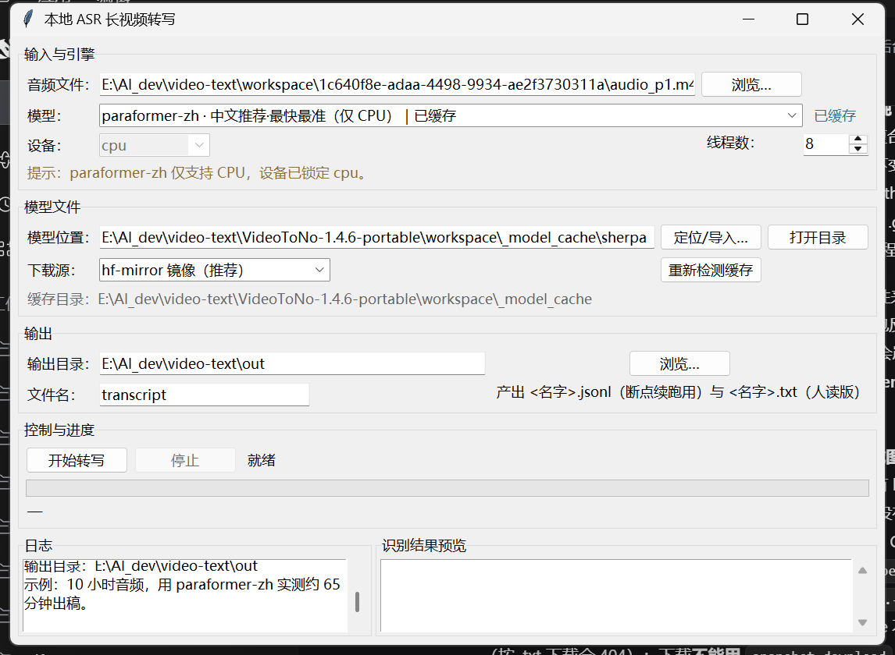
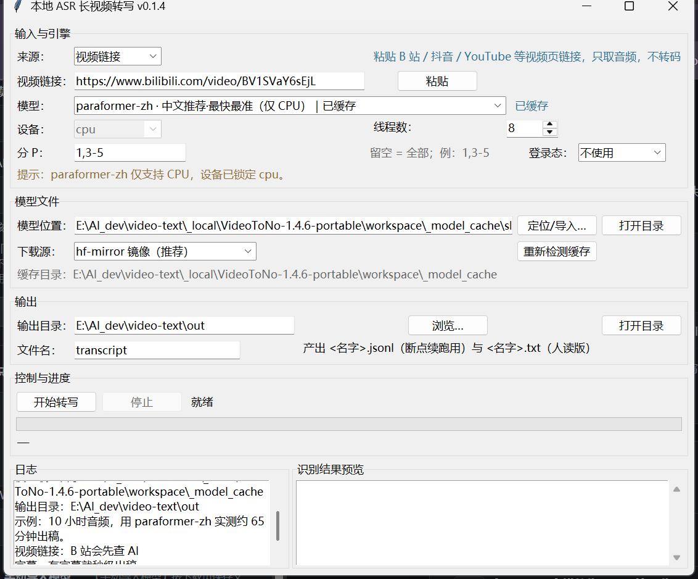
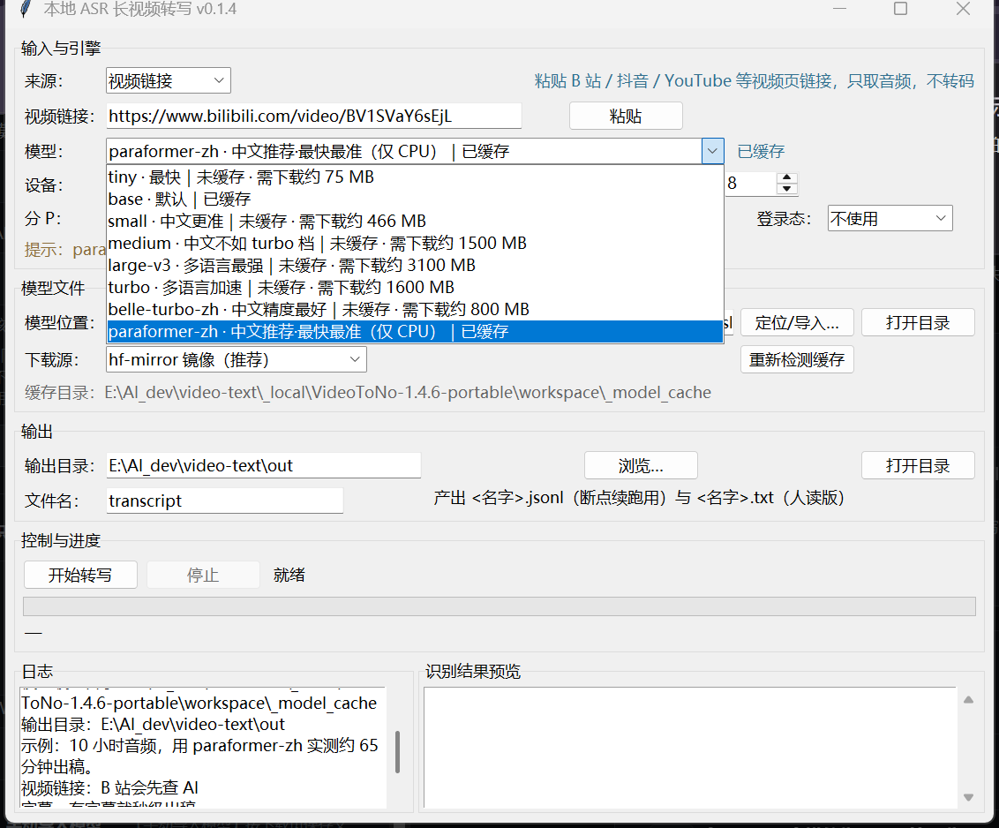

# asr-gui

**简体中文** · [English](README.en.md)

把几小时的视频转成带时间戳的文字，全程本地离线：不调云接口、不上传文件、不需要 Qt/Electron。
界面只用标准库 tkinter，底层是 [sherpa-onnx](https://github.com/k2-fsa/sherpa-onnx)（中文首选
`paraformer-zh`）与 [faster-whisper](https://github.com/SYSTRAN/faster-whisper)。

[](https://github.com/acemilee/asr-gui/actions/workflows/ci.yml)
[](https://github.com/acemilee/asr-gui/releases/latest)
[](LICENSE)
[](pyproject.toml)



## 特点

- **三种输入来源**：视频链接（只下音频轨）、本地音视频、`.srt` / `.vtt` 字幕文件（不需要模型）。
- **超长视频**：10 小时素材实测一次跑通，不卡死；可随时中断，重开自动续跑。
- **8 档模型一个下拉**：`tiny` 到 `large-v3`，外加为中文调优的 `paraformer-zh`；每档显示
  `已缓存` 或 `未缓存 · 需下载约 XXX MB`。
- **B 站友好**：优先用平台 AI 字幕（有则秒级出稿）、支持分 P（`1,3-5`）、可读浏览器登录态。
- **下载走镜像**：默认 `hf-mirror.com`，可切官方；`.part` 断点续传 + 体积校验。
- **输出两份**：人读的 `[HH:MM:SS] 正文` 与程序用的 JSONL，都随进度增量写入。
- **界面零额外依赖**：tkinter + 标准库；配置与日志写在仓库外，源码不含任何本机路径。

## 快速开始

### Windows（免安装）

到 [Releases](https://github.com/acemilee/asr-gui/releases/latest) 下载 `ASR-GUI.exe`（约 115 MB），
双击运行。模型不随包分发：首次在界面里选档位后点「下载模型」，或用「定位/导入…」指向已有缓存。

```bat
certutil -hashfile ASR-GUI.exe SHA256
:: 500442FA191FD68DFFC34EB45B26E916E1724E4633917AC1735D41AFA5F81350
```

exe 未签名，首次运行如遇 SmartScreen 提示，点「更多信息 → 仍要运行」。

### Windows（从源码）

```bat
setup.bat
asr_gui\run.bat
```

`run.bat` 依次尝试：`ASR_PYTHON` 环境变量 → `asr_gui\config.local.bat` → 仓库根 `.venv` → `PATH`，
找到后先预检依赖，再优先用 `pythonw.exe` 启动（不留黑框）。

### Linux / macOS

```bash
./setup.sh
.venv/bin/python asr_gui/app.py
```

tkinter 在部分发行版需单独安装：Debian/Ubuntu `sudo apt install python3-tk`，Fedora
`sudo dnf install python3-tkinter`，macOS `brew install python-tk`。PyAV 自带 FFmpeg，无需另装。

环境要求 **Python 3.9+**，CPU 即可推理。faster-whisper 走 GPU 时需 NVIDIA 显卡 + CUDA 12：
`python -m pip install nvidia-cublas-cu12 nvidia-cudnn-cu12`。`paraformer-zh` 仅支持 CPU。

## 输入来源

| 来源 | 输入 | 行为 | 需要模型 |
| --- | --- | --- | --- |
| 视频链接 | 页面 URL、整段分享文案、省略 `https://` 的链接、裸 `BV1M6pc65Eox` | B 站先查 AI 字幕，无字幕才用 yt-dlp 只下音频轨再转写 | 视字幕而定 |
| 本地文件 | 音频或视频文件 | 直接解码转写 | 需要 |
| 字幕文件 | `.srt` / `.vtt` | 解析时间轴，立即写出 txt + jsonl | 不需要 |



三种来源都可从命令行复现：

```bat
ASR-GUI.exe --transcribe sample.m4a --out out.txt --model paraformer-zh
ASR-GUI.exe --transcribe "https://www.bilibili.com/video/BV..." --pages 1,3-5 --cookies-from-browser chrome
ASR-GUI.exe --transcribe sample.srt --out out.txt
ASR-GUI.exe --selftest "%TEMP%\asr-gui-selftest.txt"
```

参数：`--out` `--model` `--device` `--threads` `--pages` `--cookies-from-browser` `--cookies`
`--no-subtitle-first`。

## 模型

均为按需下载后本地缓存，仓库名即实际使用的转换仓。

| 档位 | 后端 | 体积 | 设备 |
| --- | --- | --- | --- |
| `paraformer-zh` | sherpa-onnx（识别 + 标点 + VAD） | 约 520 MB | 仅 CPU |
| `tiny` / `base` / `small` | faster-whisper | 75 / 142 / 466 MB | CPU / CUDA |
| `medium` / `large-v3` | faster-whisper | 1.5 GB / 3.1 GB | CPU / CUDA |
| `turbo` / `belle-turbo-zh` | faster-whisper | 1.6 GB / 0.8 GB | CPU / CUDA |

中文长视频推荐 `paraformer-zh`：非自回归结构，CPU 上又快又准。whisper 各档的 CT2 仓库文件集并不统一，
下载器按档位请求正确文件并做体积下限校验。模型权重许可由各上游仓库定义，见
[THIRD_PARTY_NOTICES.md](THIRD_PARTY_NOTICES.md)。



## 输出

```text
[00:00:03] 大家好，欢迎来到本期节目。
[00:00:09] 今天我们聊一聊长视频转写。
```

```json
{"start": 3.52, "end": 8.97, "text": "大家好，欢迎来到本期节目。"}
```

`<名字>.txt` 供阅读，`<名字>.jsonl` 供续跑与二次处理，两者随进度增量写入。多分 P 视频先写
`<名字>.p1.jsonl`、`<名字>.p2.jsonl`，全部结束后按时间轴合并为一份 txt。

## 性能

测试环境：i9-13980HX / 63.6 GB / RTX 4060 Laptop；素材为真实 10 小时中文视频（35990 s）。

| 档位 | 硬件 | 耗时 |
| --- | --- | --- |
| `paraformer-zh`，16 线程，10 小时整片 | CPU | **19 分 51 秒**（v0.1.5 exe 实测，3181 段） |
| 同上，另一轮 CPU 负载较高时 | CPU | 64.8 分钟 |
| `faster-whisper base`，fp16 | GPU | RTF 0.031（短切片基准） |

经验值：桌面 CPU + `paraformer-zh`，每 10 小时音频约 20–70 分钟，取决于负载与降频。解码本身很便宜：
PyAV → 16 kHz 单声道，RTF 约 0.0014。

## 开发与测试

```bash
python -m pip install -r requirements-dev.txt
python -m pytest tests -q      # 239 个用例，约 4 秒，不联网、不下载模型
python -m ruff check asr_gui tests
```

测试不依赖推理库（引擎内延迟导入），CI 因此无需安装数 GB 运行时。CI 三组任务：`ruff` + `compileall`；
Windows/Ubuntu × Python 3.11/3.13 跑测试；`.bat` 必须为 ASCII + CRLF 的编码回归。

打包说明见 [packaging/README.md](packaging/README.md)，变更记录见 [CHANGELOG.md](CHANGELOG.md)。

## 已知限制

1. 进度以 300 s 分块为单位上报，块内无更细反馈；whisper 分支的取消只在块边界生效。
2. 续跑点取 JSONL 中最大的 `end`，跨块边界的 VAD 段可能重复一次或丢一小段。
3. 界面只有中文；命令行与文档中英双语。
4. 一次只转一个文件，暂无批量队列与字幕格式导出。
5. exe 未签名；只读浏览器已有登录态，不做扫码登录。

## 致谢

灵感来自 [like-attract/video-to-note](https://github.com/like-attract/video-to-note)（MIT）——超长视频
的卡死根因即在其打包版上定位，本项目引擎为独立重写。真正干活的是
[sherpa-onnx](https://github.com/k2-fsa/sherpa-onnx)、
[faster-whisper](https://github.com/SYSTRAN/faster-whisper)、
[CTranslate2](https://github.com/OpenNMT/CTranslate2)、[PyAV](https://github.com/PyAV-Org/PyAV)
与 [yt-dlp](https://github.com/yt-dlp/yt-dlp)。

## 许可

[MIT](LICENSE) © 2026 asr-gui contributors。第三方组件与模型权重适用各自许可，详见
[THIRD_PARTY_NOTICES.md](THIRD_PARTY_NOTICES.md)。
