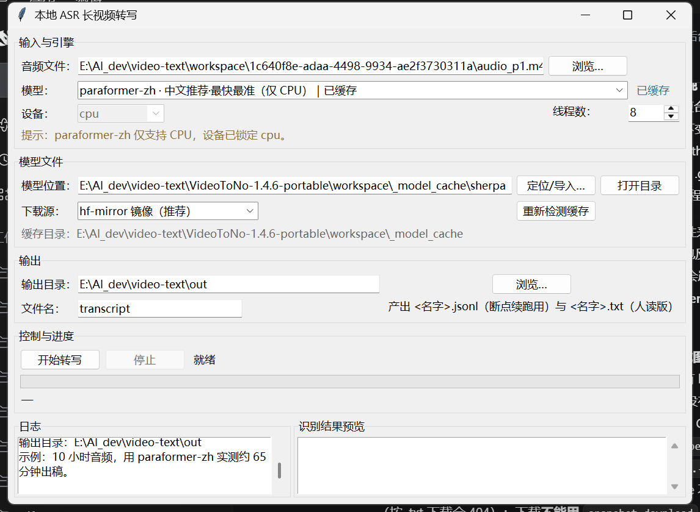
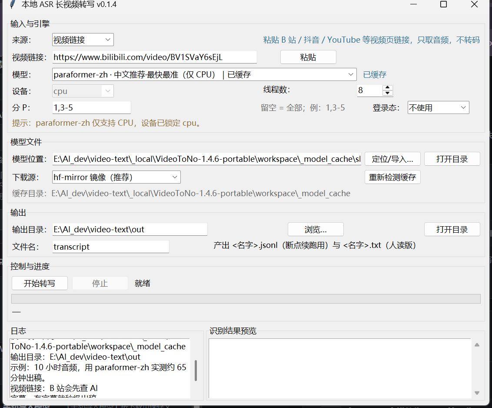
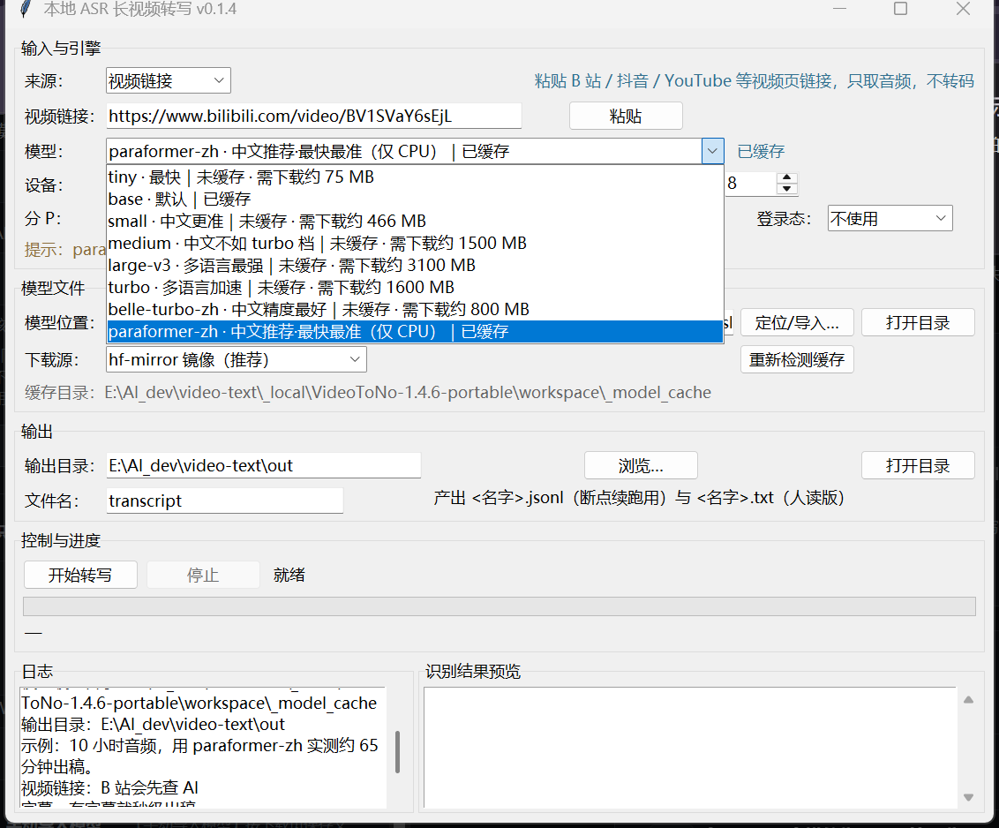

# asr-gui

**把动辄几小时的视频转成带时间戳的文字，全程本地离线完成。** 一个 tkinter 小工具，底层用
[sherpa-onnx](https://github.com/k2-fsa/sherpa-onnx) 和 [faster-whisper](https://github.com/SYSTRAN/faster-whisper)：
不调云接口、不上传文件、不依赖 Qt/Electron，只要有 Python 3.9+ 和标准库就能跑。

[](https://github.com/acemilee/asr-gui/actions/workflows/ci.yml)
[](LICENSE)
[](pyproject.toml)
[](https://github.com/acemilee/asr-gui/releases/latest)
[](https://github.com/acemilee/asr-gui/releases)







## 为什么做这个

多数「视频转笔记」工具在短视频上都没问题，一到长视频就露馅：打包版把解码后的音频通过管道喂给
子进程，只要管道缓冲区写满（64 KiB 就是那个临界点），子进程读得慢一点，整个任务就「永远卡在
80%」。9 小时以上的视频尤其明显。`asr-gui` 是针对这个问题重写的：单进程、按固定时长分块解码、
每块结束就把结果落盘、随时可取消可续跑。

## 特性

- **三种输入来源**——「视频链接」直接粘贴 B 站 / 抖音 / YouTube 页面链接，程序只把音频轨下下来
  （不转码、不碰画面），再交给转写引擎；「本地文件」选硬盘上的音频或视频；「字幕文件」直接吃
  `.srt` / `.vtt`，不加载模型、几乎瞬间出稿。链接下载走 [yt-dlp](https://github.com/yt-dlp/yt-dlp)。
- **B 站三件套**——①**AI 字幕优先**：有字幕轨就直接出稿，秒级完成、完全不占模型；②**分 P 选择**：
  `分 P` 填 `1,3-5`（留空是全部），时间轴按分 P 顺序自动累加后合并成一份 txt；③**登录态**：可从
  Chrome / Edge / Firefox 读 cookie（拿 AI 字幕通常需要登录），读不到就回落语音转写。
- **下拉里 8 档模型**——从 `tiny`（约 75 MB，几乎瞬秒）到 `large-v3`（约 3.1 GB），外加为中文调过的
  `paraformer-zh`。每档直接显示 `已缓存` 或 `未缓存·需下载 ~XXX MB`。
- **下载默认走镜像**——默认 `https://hf-mirror.com`，界面里可切回 `https://huggingface.co`。走的是
  自写的流式下载：`*.part` 断点续传、按 `Content-Length` 校验完整性、失败自动重试，不依赖
  `huggingface_hub` 那套 snapshot 机制。
- **断点续跑**——每识别出一段就追加进 JSONL 检查点。中途关窗、休眠、断网都没关系，重新选同一个
  输出目录（旁边的「打开目录」按钮可以直接打开它），会先问你是接着写还是重来。
- **可取消**——点停止后，最迟一个分块（300 s）内停住，已经写入的内容全部保留。
- **为长音频设计**——10 小时 / 35990 s 的视频，`paraformer-zh` 纯 CPU 实测约 65 分钟跑完
  （见[性能](#性能)）。
- **零重 GUI 依赖**——界面只用标准库 tkinter，运行时依赖只有 ASR 那一套。
- **配好即离线**——模型缓存好之后，转写过程完全不碰网络。
- **两种输出**——给人看的 `[HH:MM:SS] 正文` 文本，和给程序用的 JSONL，两者都是边转边写。
- **可以导入已有模型**——点「定位/导入…」直接指向硬盘上已经下好的模型目录（例如别的工具留下的
  缓存），不用重新下载；目录会先做文件完整性校验，不合格就不收。
- **配置与日志都在仓库外**——界面上的选择存进用户配置目录，源码里不写死任何本机路径；未捕获的
  异常会写进 `logs/error-<日期>.log`，不弹一个英文 traceback 就消失。

## 快速开始

运行依赖（`pip install -r requirements.txt`）：`sherpa-onnx`（paraformer-zh / VAD / 标点）、
`faster-whisper` + `ctranslate2`（whisper 各档）、`av`（PyAV，流式解码长视频）、`numpy`，以及
`yt-dlp`（只用于「视频链接」来源；不用链接可以不管它）。

环境要求：**Python 3.9+**，x86-64 或 Apple Silicon 的普通笔记本都能跑 CPU 推理；faster-whisper 走
GPU 时另需 NVIDIA 显卡 + CUDA 12。

### Windows：不想装 Python？直接下 exe

在 [Releases](https://github.com/acemilee/asr-gui/releases) 页面下载 `ASR-GUI.exe`（约 115 MB），双击即可运行；模型不随包分发，首次在界面里选模型点「下载模型」，或点「定位/导入…」指向
已有的模型缓存目录。校验文件完整性：

```bat
certutil -hashfile ASR-GUI.exe SHA256
```

exe 还带两个命令行入口，方便排查问题与批处理：

```bat
ASR-GUI.exe --selftest "%TEMP%\asr-gui-selftest.txt"                     :: 环境自检
ASR-GUI.exe --transcribe sample.m4a --out out.txt --model paraformer-zh   :: 本地文件转写
ASR-GUI.exe --transcribe "https://www.bilibili.com/video/BV..." --out out.txt  :: 链接（自动下音频）
ASR-GUI.exe --transcribe sample.srt --out out.txt                         :: 字幕文件直接出稿
```

`--transcribe` 的输入与界面里的「来源」一致：本地音视频、视频页链接（只下音频）、或 `.srt` / `.vtt` 字幕文件（不需要模型）。

### Windows：从源码跑

```bat
setup.bat
asr_gui\run.bat
```

或者直接双击 `asr_gui\启动转写GUI.bat`。`run.bat` 找解释器的顺序是：环境变量 `ASR_PYTHON` →
`asr_gui\config.local.bat` → 仓库根 `.venv` → `PATH` 里的 `python.exe` → 便携版 venv；找到后先预检
`import sherpa_onnx, av, numpy`，通过则优先用同目录的 `pythonw.exe` 启动，不留黑框。

已经有一个装好依赖的 Python 的话，也可以直接：

```bat
python asr_gui\app.py
```

### Linux / macOS

```bash
./setup.sh
.venv/bin/python asr_gui/app.py
```

tkinter 在部分发行版里是单独拆包的：Debian/Ubuntu 用 `sudo apt install python3-tk`，Fedora 用
`sudo dnf install python3-tkinter`，Homebrew 用 `brew install python-tk`。PyAV 自带 FFmpeg，不需要
另外装。

### GPU（可选）

faster-whisper 通过 CTranslate2 调 CUDA，需要 CUDA 12 的 cuBLAS 和 cuDNN 运行时：

```bash
python -m pip install nvidia-cublas-cu12 nvidia-cudnn-cu12
```

`pyproject.toml` 里的可选 extra `gpu` 列的就是这两个包（等打包方式确定后即可直接安装）。
`paraformer-zh` 只能用 CPU，选中它时界面会把设备锁到 cpu。

## 三种输入来源

界面最上面的「来源」下拉框决定这一轮吃什么：

| 来源 | 你给它什么 | 它做什么 | 需要模型吗 |
| --- | --- | --- | --- |
| 视频链接 | 页面 URL、B 站「复制分享」的整段文案（标题 + 话题 + 链接）、省略 `https://` 的站内链接，甚至裸 `BV1M6pc65Eox` 都行——会自动归一化成一个可直接下载的链接 |  B 站先查 AI 字幕（有就秒级出稿、跳过下载与转写）；没有字幕或非 B 站才用 yt-dlp 只下音频轨到 `<程序目录>/downloads`（exe 版是 `%APPDATA%\asr-gui\downloads`），再照常分块转写 | 取决于有没有字幕 |
| 本地文件 | 音频或视频文件的路径 | 直接解码转写，常见容器都行 | 需要 |
| 字幕文件 | `.srt` / `.vtt` 文件 | 解析时间轴与正文，立刻写 txt + jsonl | **不需要** |

链接下载是有意做成「只下音频」的：B 站等站的视频轨动辄上 GB，而转写只需要音轨；不转码是因为
PyAV 本来就能直接解 `m4a` / `webm`，多一道 ffmpeg 反而更容易出问题。下载中途点「停止」，
yt-dlp 会被打断，已下载的 `.part` 片段留在 `downloads` 里，下次自动续传。

**B 站细节**：先调 `x/web-interface/view`（风控时退 `x/player/pagelist`）列出所有分 P，再用
`x/player/wbi/v2`（带 wbi 签名）查每个 P 的 AI 字幕轨；多分 P 时每 P 单独下载（`?p=N`），先写
`<名字>.p1.jsonl`、`<名字>.p2.jsonl`，全部结束后按时间轴合并成一份 `<名字>.txt`。AI 字幕需要
登录态，未登录时接口返回空、自动回落语音转写——日志里会写「没有可用的 B 站字幕轨，改走语音转写。」

看到的界面就是上面第三张图：选「视频链接」，贴 B 站地址（分享文案整段贴也行），`分 P` 填 `1,3-5`、`登录态` 选 Chrome（拿 AI 字幕需要），点「开始转写」。跑完点「打开目录」就能看到 `<名字>.txt`。

命令行同样支持：`--pages 1,3-5`、`--cookies-from-browser chrome`、`--cookies cookies.txt`
（Netscape 格式）、`--no-subtitle-first`（故意跳过字幕、强制走语音）。

## 模型

所有档位都是按需从 Hugging Face（或镜像）下载后缓存在本地。下表里的仓库名就是实际使用的
CTranslate2 / sherpa-onnx 转换仓。

| 档位 | 后端 | Hugging Face 仓库 | 下载体积 | 设备 |
| --- | --- | --- | --- | --- |
| `tiny` | faster-whisper (CT2) | `Systran/faster-whisper-tiny` | 约 75 MB | CPU / CUDA |
| `base` | faster-whisper (CT2) | `Systran/faster-whisper-base` | 约 142 MB | CPU / CUDA |
| `small` | faster-whisper (CT2) | `Systran/faster-whisper-small` | 约 466 MB | CPU / CUDA |
| `medium` | faster-whisper (CT2) | `Systran/faster-whisper-medium` | 约 1.5 GB | CPU / CUDA |
| `large-v3` | faster-whisper (CT2) | `Systran/faster-whisper-large-v3` | 约 3.1 GB | CPU / CUDA |
| `turbo` | faster-whisper (CT2) | `deepdml/faster-whisper-large-v3-turbo-ct2` | 约 1.6 GB | CPU / CUDA |
| `belle-turbo-zh` | faster-whisper (CT2) | `wolfofbackstreet/faster-whisper-belle-whisper-large-v3-turbo-zh-ct2-int8` | 约 0.8 GB | CPU / CUDA |
| `paraformer-zh` | sherpa-onnx | `csukuangfj/sherpa-onnx-paraformer-zh-2023-09-14` + 标点 + VAD 三个仓 | 合计约 520 MB | 仅 CPU |

几点说明：

- `paraformer-zh` 是默认档，也是中文长视频的最佳选择：非自回归结构，CPU 上快且准，标点由单独的
  `ct-transformer` 模型补。它其实是三个仓的组合——识别（`model.int8.onnx` + `tokens.txt`）、标点
  （`model.onnx`）、Silero VAD。
- whisper 的 CT2 转换仓所需文件并不统一（有的用 `vocabulary.txt`，有的用 `vocabulary.json` 且必须
  带上 `preprocessor_config.json`）；下载器按档位请求正确的文件集，并用体积下限校验，避免把截断的
  缓存文件当成好的。
- 模型权重的许可由各上游仓库自行定义，使用前请自己确认——见
  [THIRD_PARTY_NOTICES.md](THIRD_PARTY_NOTICES.md)。

### 下载是怎么做的

下载器直接发 `GET {endpoint}/{repo}/resolve/main/{file}` 流式拉取，先写 `<file>.part`，续传时带
`Range` 头，收完按 `Content-Length` 校验体积再改名落位。**故意不用**
`huggingface_hub.snapshot_download`：镜像的 302 跳转不带 `X-Repo-Commit` 头，新版 `hf_hub` 会把它
判定为完整性校验失败。

## 输出

两个文件都写进你选的输出目录。

`<名字>.txt`——人读版：

```text
[00:00:03] 大家好，欢迎来到本期节目。
[00:00:09] 今天我们聊一聊长视频转写。
```

`<名字>.jsonl`——每行一个 JSON 段，用于续跑和二次处理：

```json
{"start": 3.52, "end": 8.97, "text": "大家好，欢迎来到本期节目。"}
{"start": 9.31, "end": 13.04, "text": "今天我们聊一聊长视频转写。"}
```

## 性能

测试环境：Windows，i9-13980HX（24C/32T），63.6 GB 内存，RTX 4060 Laptop 8 GB；素材是一段真实的
10 小时中文视频（音频 35990 s）。

| 跑法 | 硬件 | 耗时 | RTF |
| --- | --- | --- | --- |
| `paraformer-zh`，16 线程，完整 10 小时整片 | CPU | **64.8 分钟** | 0.108 |
| `faster-whisper base`，fp16，短切片 | RTX 4060 Laptop | — | 0.031 |
| `large-v3-turbo`，fp16，短切片 | RTX 4060 Laptop | — | 0.035 |

**经验值：桌面 CPU + `paraformer-zh`，按每 10 小时音频 60–70 分钟估算。** whisper 那两行是短切片
基准，直接外推会低估整片耗时——笔记本长时间满载会降频，吞吐掉 3–4 倍（300 s 分块早期约 10 s，
后期约 32 s）。whisper 的整片 10 小时没有实测，按上述 GPU 配置预期在 20–30 分钟量级。

相比之下解码很便宜：PyAV → 16 kHz 单声道 的 RTF 约 0.0014，seek 到 18000 s 只要 0.4 s。

## 工作原理

```text
视频/音频文件
   │  PyAV 流式解码，每 300 s 一块
   ▼
16 kHz 单声道 float32
   │  sherpa-onnx Silero VAD 切出语音段
   ▼
paraformer-zh（CPU）  或  faster-whisper（CPU/CUDA）
   │  ct-transformer 加标点（paraformer 分支）
   ▼
增量追加 → <名字>.jsonl + <名字>.txt
```

| 文件 | 作用 |
| --- | --- |
| `asr_gui/engine.py` | 转写引擎：分块解码、VAD、识别、标点、增量 JSONL、断点续跑、取消 |
| `asr_gui/app.py` | tkinter 图形界面（唯一入口） |
| `asr_gui/models_registry.py` | 8 档模型清单、缓存检测、文件名别名、完整性校验 |
| `asr_gui/downloader.py` | 镜像/官方双源流式下载、`.part` 续传、按体积校验 |
| `asr_gui/config.py` | 用户配置读写、缓存目录探测、默认输出目录 |
| `asr_gui/run.bat` | 纯 ASCII 启动器：解释器发现 + 依赖预检 |
| `asr_gui/启动转写GUI.bat` | 4 行薄包装，`call "%~dp0run.bat"`，保留双击习惯 |
| `asr_gui/config.local.bat` | 机器本地解释器配置（已 git-ignore，不入库） |

## 配置与缓存位置

| 环境变量 | 作用 |
| --- | --- |
| `ASR_PYTHON` | 指定启动用解释器，`run.bat` 优先使用它 |
| `ASR_GUI_MODEL_DIR` | 指定模型缓存根目录；指向已有缓存时，里面已下好的档位会直接显示「已缓存」 |
| `ASR_GUI_CONFIG_DIR` | 覆盖配置文件目录（默认 `%APPDATA%\asr-gui`） |

界面上的选择（模型、设备、线程数、下载源、输出目录、上次用过的音频）在点「开始转写」和关窗时写进
`config.json`。模型默认缓存在 `%APPDATA%\asr-gui\models`，嫌占 C 盘就把 `model_cache_dir`
改到别的盘，或者用上面的环境变量指过去。

## 开发与测试

```bash
python -m pip install -r requirements-dev.txt   # 只用 numpy + av + pytest + ruff
python -m pytest tests -q                       # 90 个用例，约 3 秒，不联网、不下载模型
python -m ruff check asr_gui tests
```

测试刻意不依赖推理库（`sherpa_onnx` / `faster_whisper` 在引擎里是延迟导入的），所以 CI 不必装几 GB 的
运行时；模型缓存相关的用例用临时目录 + 稀疏文件伪造 `models--Org--Name/snapshots/*` 布局：

| 文件 | 覆盖内容 |
| --- | --- |
| `tests/test_engine_utils.py` | 时间戳格式化、时长探测、300 s 分块边界、续跑点解析 |
| `tests/test_models_registry.py` | 8 档清单、缓存完整/不完整/多快照回退、体积下限、手动目录校验 |
| `tests/test_downloader.py` | URL 候选顺序、取消语义、`.part` 落盘与改名、不引入 `huggingface_hub` |
| `tests/test_config.py` | 配置读写、未知键丢弃、损坏 JSON 回退、缓存目录探测优先级 |
| `tests/test_app_contract.py` | `app.py` 语法/导入/关键方法、无硬编码本机路径、`.bat` 必须是 ASCII+CRLF |

CI（`.github/workflows/ci.yml`）三组任务：`ruff` + `compileall`；Windows/Ubuntu × Python 3.11/3.13 跑
`pytest`；单独的 `.bat` 编码检查（第 7 节那个坑的回归）。

## 已知限制

v0.1 已知并接受的问题：

1. **进度粒度是「块」**：进度条每 300 s 才动一次，块内没有更细的反馈。
2. **取消时可能不发最后一次进度回调**，进度条会停在最后上报的百分比，不过已写入的部分是完整的。
3. **续跑点是近似值**：取 JSONL 里最大的 `end`，所以跨块边界的 VAD 段可能重复一次，或者丢掉一小段。
4. **拿不到音频时长时没有百分比**：PyAV 读不出容器时长时，进度条退化成不含百分比的滚动显示，只有
   剩余时间估算。
5. **whisper 分支的取消只在块边界生效**：paraformer 分支约每 32 ms 检查一次取消标志、响应很快，
   faster-whisper 无法在段中间打断。
6. **界面目前只有中文**；命令行和这份仓库文档是中英双语的。
7. **一次只转一个文件**：批量队列、字幕格式导出都还没做。

## 致谢

- 灵感来自 [like-attract/video-to-note](https://github.com/like-attract/video-to-note)（MIT）。超长视频
  上那个 64 KiB 子进程管道死锁，就是在它的打包版上定位出来的；本仓库的引擎是独立重写的（单进程、
  无跨进程管道、分块检查点、可取消）。模型清单与仓库映射参考过上游实现，已在
  [THIRD_PARTY_NOTICES.md](THIRD_PARTY_NOTICES.md) 里致谢并保留其 MIT 版权声明。
- 真正干活的是 [sherpa-onnx](https://github.com/k2-fsa/sherpa-onnx)、
  [faster-whisper](https://github.com/SYSTRAN/faster-whisper)、
  [CTranslate2](https://github.com/OpenNMT/CTranslate2) 和
  [PyAV](https://github.com/PyAV-Org/PyAV)。

## 许可

[MIT](LICENSE) © 2026 asr-gui contributors。第三方组件与模型权重适用各自的许可，详见
[THIRD_PARTY_NOTICES.md](THIRD_PARTY_NOTICES.md)。

English documentation: [README.md](README.md)
